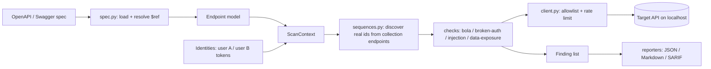

# api-security-toolkit

A small Python CLI that reads an **OpenAPI / Swagger spec** and runs automated checks for several **OWASP API Security Top 10 (2023)** risks against a live API, then writes **JSON, Markdown and SARIF** reports.

> ⚠️ **Only test systems you own or are explicitly authorized to test.** Unauthorized security testing may be illegal. The tool refuses to run without `--i-am-authorized` and only talks to `localhost` unless you add `--allow-host`.

## What it does

| Check | OWASP API Top 10 (2023) | How it works |
|---|---|---|
| `bola` | API1 Broken Object Level Authorization | Learns real object ids as user A, requests them as user B |
| `broken-auth` | API2 Broken Authentication | Calls "secured" endpoints with no, invalid and tampered tokens |
| `data-exposure` | API3 Broken Object Property Level Authorization | Flags sensitive-looking fields (`password_hash`, `token`, ...) in responses |
| `injection` | API8-style injection signals | Sends SQL metacharacters, looks for DB error signatures / new 5xx |

## Why it matters

Authorization bugs such as BOLA/IDOR are the #1 API risk and are hard for generic scanners to find because they need *two users* and *real object ids*. This tool models that explicitly. Output is SARIF, the format GitHub code scanning and Microsoft tooling consume, so findings can fit a normal AppSec CI workflow.

## Architecture



Design ideas borrowed (re-implemented, no code copied): RESTler's producer→consumer sequences, ZAP's plugin-per-check model, nuclei's SARIF output.

## Install

```bash
git clone https://github.com/Naysrania18/api-security-toolkit.git
cd api-security-toolkit
python -m venv .venv && source .venv/bin/activate   # Windows: .venv\Scripts\activate
pip install -e ".[dev]"
```

Requires Python 3.10+. No Docker required.

## Usage

```bash
# Parse a spec only (no network)
apisec list-endpoints --spec openapi.yml

# Scan a local target with two users (BOLA needs both)
export APISEC_TOKEN_A=<token of user A>
export APISEC_TOKEN_B=<token of user B>
apisec scan --spec openapi.yml --base-url http://127.0.0.1:5000 \
            --out-dir reports --i-am-authorized

# Only some checks / formats, slower rate
apisec scan ... --checks bola,broken-auth --format sarif --rate 2
```

Exit code is `1` when findings exist (so CI can fail the job), `0` when clean, `2` on usage/safety errors.

## Try it without Docker: VAmPI

[VAmPI](https://github.com/erev0s/VAmPI) is a deliberately vulnerable Flask API. It is **not** bundled here; clone it yourself:

```bash
git clone https://github.com/erev0s/VAmPI.git && cd VAmPI
python -m venv .venv && source .venv/bin/activate
pip install -r requirements.txt
# VAmPI's app.py binds 0.0.0.0; bind to localhost only instead:
python -c "from config import vuln_app; vuln_app.run(host='127.0.0.1', port=5000)"
```

In another terminal, from this repo:

```bash
eval "$(python examples/vampi_login.py)"        # registers 2 users, exports tokens
apisec scan --spec /path/to/VAmPI/openapi_specs/openapi3.yml \
            --base-url http://127.0.0.1:5000 --i-am-authorized
```

With Docker (optional, I did not test this path): `docker compose up` using the provided `docker-compose.yml`, which builds VAmPI from its upstream repo and publishes it on `127.0.0.1` only. OWASP crAPI also works as a target if you have Docker.

## Sample output

Real run against a local VAmPI (full files in [`examples/sample-output/`](examples/sample-output)):

```
[*] running bola ...        [*] running broken-auth ...
[*] running injection ...   [*] running data-exposure ...
[*] 58 requests sent
[+] 4 finding(s)
```

| # | Severity | Check | Endpoint | Confidence |
|---|---|---|---|---|
| 1 | HIGH | BOLA | `GET /books/v1/{book_title}` | low |
| 2 | HIGH | BOLA | `GET /users/v1/{username}` | low |
| 3 | MEDIUM | Data exposure | `GET /users/v1/_debug` | medium |
| 4 | MEDIUM | Injection | `GET /users/v1/{username}` | low |

**Reading these honestly:** VAmPI's book lookup is a genuine BOLA and its user-lookup has a genuine SQL injection. The `/users/v1/{username}` BOLA is probably "by design" (public profile lookup), which is why BOLA findings carry a **confidence** score: `high` only if user A's and B's object listings differ (the object provably isn't B's), `low` when listings are global and ownership can't be known. The injection finding is `low` because VAmPI hides DB errors, so only a new HTTP 500 was observed.

## Tests and CI

```bash
pytest -q          # 22 tests, run against a local vulnerable Flask app in tests/
ruff check .
bandit -r src
```

The test target (`tests/vuln_app.py`) has planted bugs *and* safe look-alike routes, so each check is tested for both detection and false positives. GitHub Actions (`.github/workflows/ci.yml`) runs pytest, ruff and Bandit on every push. [`examples/github-code-scanning.yml`](examples/github-code-scanning.yml) shows how to upload the SARIF report.

## Comparison with industry tools

| | This toolkit | RESTler (Microsoft) | OWASP ZAP | Schemathesis |
|---|---|---|---|---|
| Goal | Authorization / auth / injection signals | Stateful REST fuzzing | General DAST proxy + scanner | Spec conformance + property testing |
| Multi-user BOLA logic | Yes (core feature) | No | Via scripting/contexts | No |
| Scope | Small, readable | Large fuzzing engine | Very broad | Broad |
| SARIF | Yes | No | Via add-on | No |

This is a learning project, not a replacement for those tools.

## Limitations

- Heuristic detection: expect false positives and negatives. Findings are leads to verify, not proof.
- Only GET object lookups are tested for BOLA; no write-method BOLA, mass assignment, rate-limit or SSRF checks yet.
- Only JSON bodies, and bearer-token auth.
- Routes whose names look destructive (`createdb`, `reset`, `delete`, ...) are never probed automatically.
- Tested against my local mock app and VAmPI only.

## What I learned

TODO: write this in your own words (e.g. why BOLA needs two identities, the JWT last-character false positive I hit, how confidence scoring reduces noise, what SARIF is for).

## References / credits

- Microsoft [RESTler](https://github.com/microsoft/restler-fuzzer): producer/consumer request sequences
- OWASP [ZAP](https://github.com/zaproxy/zaproxy): plugin-per-check design, alert/report model
- [Schemathesis](https://github.com/schemathesis/schemathesis): spec-driven test generation
- ProjectDiscovery [nuclei](https://github.com/projectdiscovery/nuclei): declarative checks, SARIF output
- OWASP [crAPI](https://github.com/OWASP/crAPI) and erev0s [VAmPI](https://github.com/erev0s/VAmPI): vulnerable targets
- [OWASP API Security Top 10 (2023)](https://owasp.org/API-Security/)

## Legal / ethical disclaimer

For education and authorized testing only. You are responsible for having permission to test any target. The authors accept no liability for misuse. Never point this at systems you do not own or lack written authorization to test.

## License

MIT, see [LICENSE](LICENSE).
